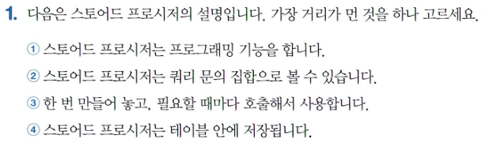
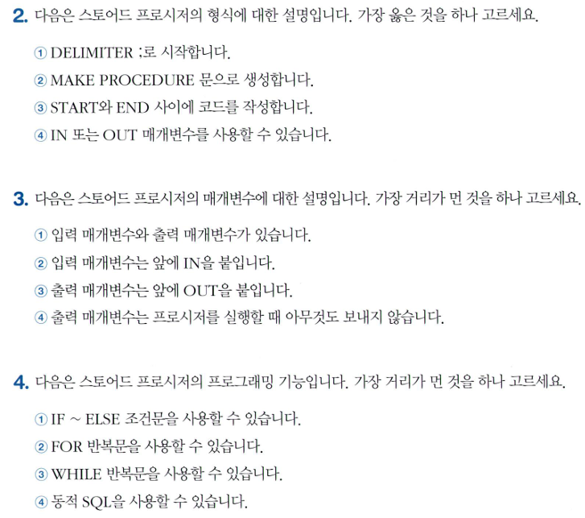
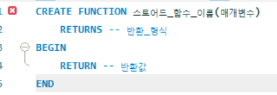
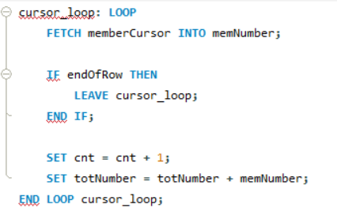
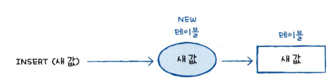
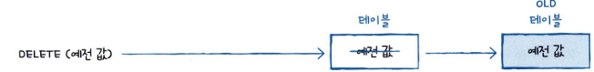
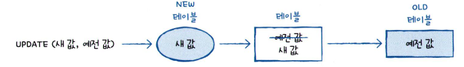
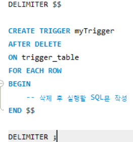

# SQL_ADVANCED 6주차 정규 과제 

📌SQL_ADVANCED 정규과제는 매주 정해진 분량의 『*혼자 공부하는 SQL*』 을 읽고 학습하는 것입니다. 이번주는 아래의 **SQL_ADVANCED_6th_TIL**에 나열된 분량을 읽고 공부하시면 됩니다.

아래의 문제를 풀어보며 학습 내용을 점검하세요. 문제를 해결하는 과정에서 개념을 스스로 정리하고, 필요한 경우 제시된 강의를 참고하여 보완하는 것이 좋습니다.

<!-- 강의 링크는 아래와 같습니다.
https://www.youtube.com/watch?v=cw1wGN0ZdFA&list=PLVsNizTWUw7GCfy5RH27cQL5MeKYnl8Pm&index=19
https://www.youtube.com/watch?v=bMQ_dAoaMzA&list=PLVsNizTWUw7GCfy5RH27cQL5MeKYnl8Pm&index=20
https://www.youtube.com/watch?v=bggWVsBmKag&list=PLVsNizTWUw7GCfy5RH27cQL5MeKYnl8Pm&index=21
-->

**교재 실습 예제 파일은 08_SQL_ADVANCED_Template 레포지토리의 src 폴더에 업로드되어 있습니다. market_db 파일도 해당 폴더에 함께 포함되어 있으니 참고하시기 바랍니다.**

**👀(수행 인증샷은 필수입니다.)** 

## SQL_ADVANCED_6th_TIL

### 7장 스토어드 프로시저
#### 01. 스토어드 프로시저 사용 방법
#### 02. 스토어드 함수와 커서
#### 03. 자동 실행되는 트리거 


## Study Schedule

| 주차  | 공부 범위     | 완료 여부 |
| ----- | ------------- | --------- |
| 1주차 | p.24~99    | ✅         |
| 2주차 | p.102~155   | ✅         |
| 3주차 | p.158~213  | ✅         |
| 4주차 | p.216~271 | ✅         |
| 5주차 | p.274~327 | ✅         |
| 6주차 | p.330~369 | ✅         |
| 7주차 | p.372~407 | 🍽️         |


<br>

<!-- 여기까진 그대로 둬 주세요-->

---

# 1️⃣ 학습 내용 정리

## 1. 스토어드 프로시저 사용 방법 
### 스토어드 프로시저 기본
#### 스토어드 프로시저의 개념과 형식
- 스토어드 프로시저(Stored Procedure) : MySQL에서 제공하는 프로그래밍 기능으로 쿼리 문의 집합으로도 볼 수 있고, 어떠한 동작일 일괄 처리하기 위한 용도로도 사용하여 필요할 때마다 간단히 호출만 하여 훨씬 편리하게 사용할 수 있게 함

#### 스토어드 프로시저 생성하는 형식
```
DELIMIER $$
CREATE PROCEDURE 스토어드_프로시저_이름(IN 또는 OUT 매개변수)
BEGIN

END $$
DELIMIER;
```

#### 스토어드 프로시저 호출 형식
``` 
CALL 스토어드_프로시저_이름();
```
#### 스토어드 프로시저 삭제 형식
```
DROP PROCEDURE user_proc;
```
### 스토어드 프로시저 실습
#### 입력 매개변수
```
IN 입력_매개변수_이름 데이터_형식
```
- 입력 매개변수가 있는 스토어드 프로시저를 실행하기 위해서는 다음과 같이 괄호 안에 값을 전달하면 된다. 
```
CALL 프로시저_이름(전달_값);
```

#### 출력 매개변수
```
OUT 출력_매개변수_이름 데이터_형식
```
- 출력 매개변수에 값을 대입하기 위해서는 주로 SELECT ~ INTO 문을 사용하고 출력 매개변수가 있는 스토어드 프로시저를 실행하기 위해서는 다음과 같이 사용한다.
```
CALL 프로시저_이름(@변수명);
SELECT @변수명;
```

#### 동적 SQL
- 테이블을 조회하는 기능을 하는데 테이블은 고정된 것이 아니라, 테이블 이름을 매개변수로 전달받아서 해당 테이블을 조회한다. 
```
DROP PROCEDURE IF EXISTS dynamic_proc;
DELIMIER $$
CREATE PROCEDURE dynamic_proc(
    IN tabelName VARCHAR(20)
)
BEGIN
    SET @sqlQuery = CONCAT('SELECT * FROM ', tableName);
    PREPARE myQuery FROM @sqlQuery;
    EXECUTE myQuery;
    DEALLOCATE PREPARE myQuery;
END $$
DELIMIER;

CALL dynamic_proc('member');
```
- 동적 SQL은 실시간으로 SQL을 만든 후에 실행한다. 


### 확인문제 - 실습

Q1
정답 : ④ 스토어드 프로시저는 테이블 안에 저장됩니다. 
근거 : 스토어드 프로시저는 **일반 테이블의 행이나 열에 저장하는 데이터가 아니라, 데이터베이스가 관리하는 독립적인 프로그램 객체** 이다. 프로시저의 정의나 관련 정보는 DBMS의 시스템 카탈로그 등에 관리된다. 

① → 스토어드 프로시저에서는 SQL문과 함께 변수, 조건문(IF), 반복문 등을 사용할 수 있다. 따라서 여러 작업을 일정한 절차에 따라 처리하는 프로그래밍이 가능하다. 

② → 여러 SQL문을 하나로 묶어 저장하고 실행할 수 있으므로 쿼리 문의 집합이라고 볼 수 있다. 다만 SQL문뿐 아니라 조건문·반복문 같은 처리 로직도 포함할 수 있습니다.

③ → 데이터베이스에 한 번 생성해 두면 이름을 지정하여 필요할 때마다 호출할 수 있습니다. 같은 SQL문을 매번 새로 작성하지 않아도 되므로 재사용할 수 있습니다. 


Q2
정답 : ④ IN 또는 OUT 매개변수를 사용할 수 있습니다. 
근거 : IN은 값을 전달받는 입력 매개변수이고, OUT은 처리 결과를 돌려주는 출력 매개변수이다. 입력과 출력을 함께 수행하는 INOUT도 있다.

① → 프로시저 내부에서는 SQL문을 구분하기 위해 세미콜론(;)을 사용한다. 따라서 프로시저를 정의할 때는 보통 DELIMIER $$ 처럼 종료 구분자를 다른 기호로 변경한다. DELIMIER ;는 정의를 마친 뒤 구분자를 원래대로 되돌릴 때 사용한다.

② → 프로시저를 생성하는 명령어는 **CREATE PROCEDURE** 이다. 

③ → 프로시저의 실행 코드는 **BEGIN과 END 사이** 에 작성한다. 

Q3
정답 : ④ 출력 매개변수는 프로시저를 실행할 때 아무것도 보내지 않습니다. 
근거 : 출력 매개변수에는 결과를 받을 변수를 전달해야 한다. 입력값을 전달하지 않는다는 뜻과, 호출할 때 아무것도 지정하지 않는다는 뜻은 다르다. 
EX)
```
CALL my_proc(@result);
SELECT @result;
```
→ 여기서 @result 는 프로시저가 처리한 결과를 받는 변수이다. 

① → 프로시저에 값을 전달하는 입력 매개변수와, 프로시저의 결과를 전달받는 출력 매개변수가 있다. 

② → 매개변수를 선언할 때 **IN 매개변수명 자료형** 으로 작성한다. 예를 들어 **IN p_num INT** 는 정수 값을 전달받는 입력 매개변수이다. 

③ → **OUT 매개변수명 자료형** 으로 선언한다. 예를 들어 **OUT p_result INT** 는 정수형 결과를 돌려주는 출력 매개변수이다. 

Q4
정답 : ② FOR 반복문을 사용할 수 있습니다. 
근거 : **MySQL의 스토어드 프로시저는 FOR 반복문을 지원하지 않는다.** 반복 처리는 **WHILE, REPEAT, LOOP를 사용** 한다. 단, 다른 DBMS에서는 FOR 반복문을 지원하기도 하므로 MySQL 기준에서는 아니다. 

① → 조건에 따라 서로 다른 SQL문을 실행할 수 있다. 예를 들어 점수가 60점 이상이면 '합격', 그렇지 않으면 '불합격'으로 처리할 수 있다. 

③ → 조건이 참인 동안 명령을 반복 실행할 수 있다. 예를 들어 변수가 10 이하인 동안 값을 1씩 증가시키는 처리가 가능하다.

④ → 실행할 SQL문을 문자열로 구성한 후, PREPARE와 EXECUTE 등을 이용해 실행할 수 있다. 

## 2. 스토어드 함수와 커서 
### 스토어드 함수
#### 스토어드 함수의 개념과 형식
- 스토어드 함수(stored function) : 사용자가 원하는 함수가 제공되지 않았을 때 사용자가 직접 함수를 만들어서 사용하는 함수
```
DELIMIER $$
CREATE FUNCTION 스토어드_함수_이름(매개변수)
    RETURNS 반환 형식
BEGIN

    이 부분에 프로그래밍 코딩
    RETURN 반환값;

END $$
DELIMIER;
SELECT 스토어드_함수_이름();
```

- 스토어드 함수의 내용 확인하는 방법
```
SHOW CREATE FUNCTION 함수_이름;
```

- 스토어드 함수의 삭제
```
DROP FUNCTION calcYearFunc;
```

### 커서로 한 행씩 처리하기
#### 커서의 기본 개념
- 커서 : 테이블에서 한 행씩 처리하기 위한 방식으로 **첫 번째 행을 처리한 후에 마지막 행까지 한 행씩 접근해서 값을 처리** 한다.
- **SELECT ~ INTO ~** 문으로 스토어드 함수의 반환값을 변수에 저장할 수 있다. 
EX)
```
SELECT calcYearFunc(2007) INTO @debut2007;
SELECT calcYearFunc(2013) INTO @debut2013;
SELECT @debut2007-@debut2013 AS '2007과 2013 차이';
```

#### 스토어드 함수의 사용
- 스토어드 함수를 사용하기 위해서는 다음 SQL로 스토어드 함수 생성 권한을 허용해줘야 한다. 
```
SET GLOBAL log_bin_trust_function_creators = 1;
```

#### 커서의 단계별 실습
1. 사용할 변수 준비하기
- 전체 인원의 합계와 읽은 행의 수를 누적시켜야 하기 때문에 DEFAULT문을 사용해서 초기값을 0으로 설정
```
DECLARE memNumber INT;
DECLARE cnt INT DEFUALT 0;
DECLARE totNumber INT DEFAULT 0;
```
- 추가로 행의 끝을 파악하기 위해 변수 endOfRow를 준비
```
DECLARE endOfRow BOOLEAN DEFAULT FALSE;
```

2. 커서 선언하기
- 커서라는 것은 SELECT 문이므로, 조회하는 구문을 커서로 만들면 된다. 
```
DECLARE memberCursor CURSOR FOR
    SELECT mem_number FROM member;
```

3. 반복 조건 선언하기
- 행의 끝에 다다르면 앞에서 선언한 endOfRow 변수를 TRUE로 설정한다. 
- **DECLARE CONTINUE HANDLER** 는 반복 조건을 준비하는 예약어이고, **FOR NOT FOUND** 는 더 이상 행이 없을 떄 이어진 문장을 수행한다. 
```
DECLARE CONTINUE HANDLER
    FOR NOT FOUND SET endOfROW = True;
```

4. 커서 열기
- 앞에서 준비한 커서를 간단히 OPEN으로 열면 된다. 
```
OPEN memberCursor;
```

5. 행 반복하기
```
cursor_loop: LOOP
    이 부분을 반복
END LOOP cursor_loop
```
- **cursor_loop** 는 반복할 부분의 이름을 지정한 것이다. 
- **LEAVE** 는 반복할 이름을 빠져나간다. 따라서 행의 끝에 다다르면 반복 조건을 선언한 것에 의해 endOfRow가 TRUE로 변경되고 반복하는 부분을 빠져나가게 된다. 
```
IF endOfRow THEN
    LEAVE cursor_loop;
END IF;
```
- **FETCH** 를 활용해서 한 행씩 읽어온다. 
```
cursor_loop: LOOP
    FETCH memberCursor INTO memNumber;

    IF endOfRow THEN
        LEAVE cursor_loop;
    END IF;

    SET cnt  = cnt + 1;
    SET totNumber = totNumber + memNumber;
END LOOP cursor_loop;
```

6. 커서 닫기
```
CLOSE memberCursor;
```

##### 정리
커서는 스토어드 프로시저 안에 코드를 작성하고, 스토어드 프로시저를 실행하면 커서가 작동되는 것이다. 

### 확인문제
Q1 다음은 스토어드 함수의 특징 또는 스토어드 프로시저와의 차이점입니다. 가장 거리가 먼 것을 하나 고르세요
정답 : ④ 스토어드 함수 안에서도 SELECT를 사용할 수 있습니다. 
근거 : 스토어드 함수에서는 다음과 같이 **조회 결과를 그대로 호출자에게 내보내는 SELECT** 를 사용할 수 없다. 
```
SELECT * FROM member;
```
하지만 조회한 값을 함수 내부 변수에 저장하는 **SELECT ~ INTO 는 사용가능하다.**
```
SELECT COUNT(*) INTO v_count FROM member;
RETURN v_count;
```

① 스토어드 함수는 RETURNS 문으로 반환할 값의 데이터 형식을 지정한다.→ 함수를 정의할 때 RETURNS INT 처럼 반환값의 자료형을 지정한다. INT이면 정수, VARCHAR(20)이면 최대 20자의 문자열을 반환한다는 뜻이다.

② 스토어드 함수는 본문 안에서 RETURN 문으로 하나의 값을 반환해야 한다. → 함수는 처리한 결과를 RETURN으로 반환한다. 예를 들어 RETURN 100;은 함수의 결과로 숫자 100을 돌려준다. 
(RETURNS : 어떤 자료형을 반환할지 선언, RETURN : 실제 결과값을 반환)

③ 스토어드 프로시저는 CALL로 호출하지만, 스토어드 함수는 SELECT 문장 안에서 호출한다. → 프로시저는 CALL 프로시저명(); 으로 호출하고, 함수는 SELECT 함수명(); 처럼 SQL의 표현식 안에서 사용할 수 있다. 

Q2 다음은 스토어드 함수의 형식이다. 빈칸에 들어갈 것을 보기에서 고르세요


Q3 다음은 커서의 작동 순서입니다. 차례대로 나열하세요.
커서 선언하기 → 반복 조건 선언하기 → 커서 열기 → 데이터 가져오기 및 데이터 처리하기 → 커서 닫기

Q4 다음은 커서가 반복할 부분의 예입니다. 빈칸에 들어갈 것을 보기에서 고르세요.



## 3. 자동 실행되는 트리거 
### 트리거 기본
#### 트리거의 개요
- 트리거 : 테이블에 INSERT나 UPDATE 또는 DELETE 작업이 발생하면 실행되는 코드

#### 트리거의 기본 작동
- 테이블에서 DML문(INSERT, UPDATE, DELETE 등)의 이벤트가 발생할 때 작동한다. 
- 테이블에 미리 부착되는 프로그램 코드라고 생각하면 된다. 
```
DROP TRIGGER IF EXISTS myTrigger;
DELIMIER $$
CREATE TRIGGER myTrigger
    AFTER DELETE
    ON trigger_table
    FOR EACH ROW
BEGIN
    SET @msg = '가수 그룹이 삭제됨' ; --트리거 실행 시 작동되는 코드들
END $$
DELIMIER;
```
- AFTER DELETE는 이 트리거는 DELETE 문이 발생된 이후에 작동하라는 의미이다. 

### 트리거 활용
- 테이블에 입력/수정/삭제되는 정보를 백업하는 용도로 활용할 수 있다. 
- 테이블에 이벤트가 먼저 적용된 후에 트리거가 실행된다. 
- 테이블에 INSERT나 UPDATE 작업이 일어나는 즉, 이벤트가 일어나는 경우 변경되기 전의 데이터를 저장할 백업 테이블을 미리 생성해놓는다. 
```
DROP TRIGGER IF EXISTS singer_updateTrg;
DELIMIER $$
CREATE TRIGGER singer_updateTRG
    AFTER UPDATE
    ON singer
    FOR EACH ROW
BEGIN
    INSERT INTO backup_singer VALUES(OLD.mem_id, OLD.mem_name, OLD.mem_number, OLD.addr, '수정', CURDATE(), CURRENT_USER());
END $$
DELIMIER;
```
- OLD 테이블은 UPDATE나 DELETE가 수행될 때, 변경되기 전의 데이터가 잠깐 저자오디는 임시 테이블이다. 
- OLD 테이블에 UPDATE 문이 작동되면 이 행에 의해서 업데이트되기 전의 데이터가 백업 테이블에 입력된다. 
+) OLD 테이블은 MySQL에서 내부적으로 제공되는 테이블이다. 
+) TRUNCATE TABEL 테이블_이름과 DELETE FROM 테이블_이름은 동일한 효과를 낼 수 있다. 

#### 트리거가 사용하는 임시 테이블
- NEW 테이블 : INSERT문이 실행되면 다음과 같이 작동한다. 


- OLD 테이블은 DELETE 문이 실행되면 다음과 같이 작동된다. 

**OLD.열 이름** 형식으로 예전 값에 접근할 수 있었다. 

- UPDATE의 경우는 NEW 테이블과 OLD 테이블 모두 사용한다. 


### 확인문제
Q1 다음은 트리거의 기본 작동에 대한 설명입니다. 가장 거리가 먼 것을 하나 고르세요.
정답 : ① SELECT, INSERT, UPDATE, DELETE 문이 발생할 때 작동됩니다. 
근거 : 트리거는 테이블에 **INSERT, UPDATE, DELETE가 발생할 때** 실행된다. 데이터를 조회하는 SELECT는 트리거를 작동시키지 않는다. 

② 트리거는 자동으로 작동된다. → 트리거를 생성해 두면 지정한 이벤트가 발생할 때 자동으로 실행된다. 사용자가 매번 별도로 호출할 필요가 없다. 

③ 트리거는 테이블에 부착됩니다. → 트리거는 특정 테이블과 연결하여 정의한다. 예를 들어 회원 테이블에서 데이터가 삭제될 때, 삭제 내역을 기록하는 트리거를 만들 수 있다. 

④ 스토어드 프로시저와 문법은 비슷합니다. → 트리거도 BEGIN ~ END 안에 실행할 SQL 문을 작성하고, 변수나 조건문 등을 사용할 수 있어 스토어드 프로시저와 문법이 비슷하다. 

Q2 다음은 트리거와 스토어드 프로시저의 차이점입니다. 가장 옳은 것을 하나 고르세요.
정답 : ④ 트리거는 이벤트가 발생되면 자동으로 실행된다. 
근거 : 트리거를 정의할 때 지정한 INSERT, UPDATE, DELETE 이벤트가 발생하면 자동 실행된다. 이벤트의 실행 전(BEFORE) 또는 실행 후 (AFTER)에 작동하도록 설정할 수 있다. 

② 트리거는 스토어드 프로시저와 마찬가지로 매개변수를 사용할 수 있습니다. → 트리거에는 프로시저처럼 매개변수를 선언하여 전달받는 기능이 없다. 대신 OLD와 NEW를 이용해 변경 전후의 행 데이터를 접근한다. 

③ 트리거는 입력 매개변수만 사용할 수 있다. → 트리거는 입력 매개변수도 사용할 수 없다. IN, OUT, INOUT 매개변수를 선언하는 방식은 트리거에 적용되지 않는다. 

Q3 다음은 트리거의 형식입니다. 빈칸에 들어갈 것을 보기에서 고르세요.


Q4 AFTER DELETE 트리거를 부착시킬 때 작동하는 이벤트를 고르세요.
정답 : ② DELETE
근거 : 지정한 테이블에서 DELETE로 행을 삭제하면, 삭제된 각 행에 대해 AFTER DELETE 트리거가 실행된다. 

① SELECT → 데이터를 조회하는 명령이므로 삭제 트리거를 작동시키지 않는다. 

③ TRUNCATE → 테이블의 데이터를 모두 제거하지만, MySQL에서는 DELETE 트리거를 작동시키지 않는다. 

④ UPDATE → 데이터를 수정하는 명령어이다. UPDATE 이벤트로 정의된 트리거가 실행되며, DELETE 트리거는 실행되지 않는다. 

Q5 다음은 OLD 및 NEW 테이블의 설명입니다. 가장 거리가 먼 것을 고르세요.
정답 : ④ TRUNCATE가 실행되면 OLD에는 기존 값, NEW에는 새 값이 저장됩니다. 
근거 : TRUNCATE는 삭제 트리거를 실행하지 않으므로, 트리거의 OLD나 NEW로 해당 작업의 행 값을 참조할 수 없다.

① INSERT가 실행되면 NEW에 새 값이 저장됩니다. → 새로 삽입되는 행의 값을 **NEW.열이름** 으로 참조할 수 있다. 삽입 전의 행은 없으므로 OLD는 사용할 수 없다.

② DELETE가 실행되면 OLD에는 기존 값이 저장됩니다. → 삭제되는 행의 기존 값을 **OLD.열이름** 으로 참조할 수 있다. 삭제 후의 새 행은 없으므로 NEW는 사용할 수 없다.

③ UPDATE가 실행되면 OLD에는 기존 값, NEW에는 새 값이 저장됩니다. → 수정 전 값은 OLD, 수정 후 값은 NEW로 참조한다. 예를 들어 나이가 20에서 21로 변경되면 OLD.age는 20, NEW.age는 21이다.


---


### 🎉 수고하셨습니다.


