# SQL_ADVANCED 7주차 정규 과제 

📌SQL_ADVANCED 정규과제는 매주 정해진 분량의 『*혼자 공부하는 SQL*』 을 읽고 학습하는 것입니다. 이번주는 아래의 **SQL_ADVANCED_7th_TIL**에 나열된 분량을 읽고 공부하시면 됩니다.

아래의 문제를 풀어보며 학습 내용을 점검하세요. 문제를 해결하는 과정에서 개념을 스스로 정리하고, 필요한 경우 제시된 강의를 참고하여 보완하는 것이 좋습니다.

<!-- 강의 링크는 아래와 같습니다.
https://www.youtube.com/watch?v=KZmW6VaY5BU&list=PLVsNizTWUw7GCfy5RH27cQL5MeKYnl8Pm&index=16
https://www.youtube.com/watch?v=vWTDuoSG-YQ&list=PLVsNizTWUw7GCfy5RH27cQL5MeKYnl8Pm&index=17
https://www.youtube.com/watch?v=aiMSluMNzI8&list=PLVsNizTWUw7GCfy5RH27cQL5MeKYnl8Pm&index=18
-->

**교재 실습 예제 파일은 08_SQL_ADVANCED_Template 레포지토리의 src 폴더에 업로드되어 있습니다. market_db 파일도 해당 폴더에 함께 포함되어 있으니 참고하시기 바랍니다.**

**👀(수행 인증샷은 필수입니다.)** 

## SQL_ADVANCED_7th_TIL

### 8장 SQL과 파이썬 연결 
#### 01. 파이썬 개발 환경 준비
#### 02. 파이썬과 MySQL의 연동
#### 03. GUI 응용 프로그램 


## Study Schedule

| 주차  | 공부 범위     | 완료 여부 |
| ----- | ------------- | --------- |
| 1주차 | p.24~99    | ✅         |
| 2주차 | p.102~155   | ✅         |
| 3주차 | p.158~213  | ✅         |
| 4주차 | p.216~271 | ✅         |
| 5주차 | p.274~327 | ✅         |
| 6주차 | p.330~369 | ✅         |
| 7주차 | p.372~407 | ✅         |


<br>

<!-- 여기까진 그대로 둬 주세요-->

---

# 1️⃣ 학습 내용 정리

## 1. 파이썬 개발 환경 준비
### 파이썬 설치
#### 외부 라이브러리 설치
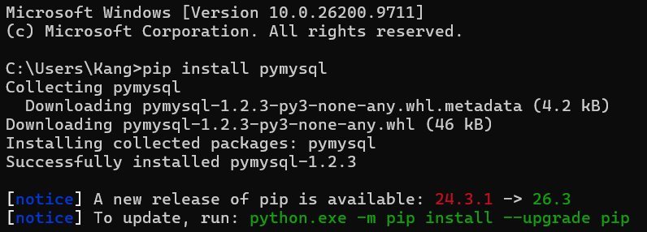

### 파이썬 사용방법
#### 대화형 모드: 한 줄씩 실행하기
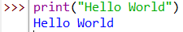

#### 스크립트 모드: 여러 줄을 한 번에 실행하기
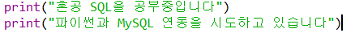

### 확인문제
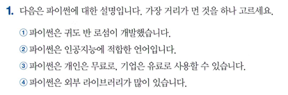

정답 : ③

-> 파이썬(Python)은 오픈소스 프로그래밍 언어로, 개인과 기업 모두 무료로 사용할 수 있습니다. 

**보기별 해설**

① 파이썬은 네덜란드의 프로그래머 귀도 반 로섬(Guido van Rossum)이 개발한 언어이다. 

② 파이썬은 TensorFlow, PyTorch 등 다양한 라이브러리를 지원하여 인공지능 및 머신러닝 개발에 널리 사용된다.

④ 파이썬은 데이터 분석, 웹 개발, 인공지능 등 다양한 분야에서 활용할 수 있는 외부 라이브러리가 풍부하다.


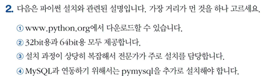

정답 : ③

-> 파이썬은 설치 과정이 비교적 간단하여 전문 지식이 없는 일반 사용자도 쉽게 설치할 수 있다.

**보기별 해설**

① 파이썬은 공식 홈페이지에서 무료로 다운로드할 수 있다.

② 파이썬은 32비트와 64비트 환경을 지원하는 설치 버전을 제공한다. 단, 운영체제와 버전에 따라 제공 여부가 다를 수 있다.

④ 파이썬에서 MySQL 데이터베이스에 연결할 때 PyMySQL 라이브러리를 추가로 설치하여 사용할 수 있다. 다만 mysql-connector-python 등 다른 라이브러리도 사용할 수 있으므로 PyMySQL이 반드시 필요한 것은 아니다.


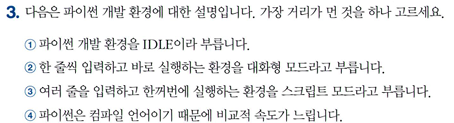

정답 : ④
-> 파이썬은 일반적으로 인터프리터 언어로 분류된다. 실행 과정에서 바이트코드로 컴파일하는 단계가 있지만, 일반적인 컴파일 언어와 실행 방식이 다르다. 파이썬은 일부 컴파일 언어보다 실행 속도가 느릴 수 있다. 
**보기별 해설**
① IDLE은 파이썬에서 기본적으로 제공하는 통합 개발 환경(IDE)으로, 파이썬 코드를 작성하고 실행할 수 있다. 단, 파이썬 개발 환경에는 IDLE 외에도 여러 종류가 있다.
② 대화형 모드(Interactive Mode)는 코드를 한 줄씩 입력하고 즉시 실행 결과를 확인할 수 있는 방식이다.
③ 스크립트 모드(Script Mode)는 여러 줄의 코드를 파일에 작성한 후 한꺼번에 실행하는 방식이다. 

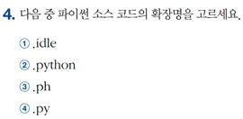

정답 : ④
-> 파이썬 소스 코드 파일의 표준 확장자로, 작성한 코드를 저장하고 실행할 때 사용한다.
**보기별 해설**
① IDLE은 파이썬에서 기본적으로 제공하는 통합 개발 환경(IDE)의 이름이며, 파이썬 소스 코드의 확장자가 아니다.
② 파이썬 언어의 전체 이름을 나타내지만, 일반적인 파이썬 소스 코드 파일의 확장자는 아니다.
③ 파이썬 소스 코드 파일에 사용하는 확장자가 아니다.

## 2. 파이썬과 MySQL의 연동
### 연동 프로그래밍 기본
#### 연동 프로그램을 위한 쇼핑몰 생성
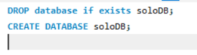

#### 파이썬에서 데이터 입력
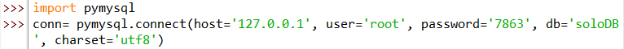
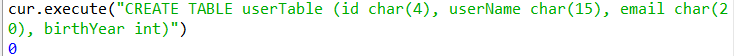
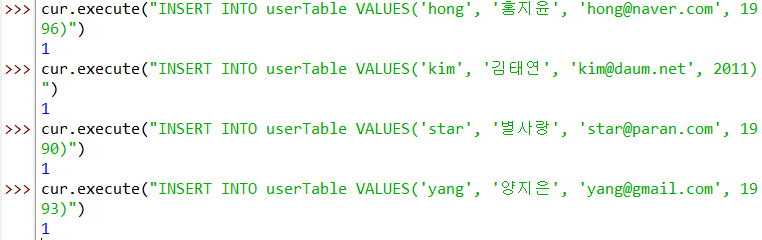
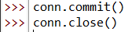

### 연동 프로그래밍 활용
#### 완전한 데이터 입력 프로그램의 완성
```
import pymysql

# 전역변수 선언부
conn, cur = None, None
data1, data2, data3, data4 = "", "", "", ""
sql=""

# 메인 코드
conn = pymysql.connect(host='127.0.0.1', user='root', password='0000', db='soloDB', charset='utf8')
cur = conn.cursor()

while (True) :
    data1 = input("사용자 ID ==> ")
    if data1 == "" :
        break;
    data2 = input("사용자 이름 ==> ")
    data3 = input("사용자 이메일 ==> ")
    data4 = input("사용자 출생연도 ==> ")
    sql = "INSERT INTO userTable VALUES('" + data1 + "','" + data2 + "','" + data3 + "'," + data4 + ")"
    cur.execute(sql)

conn.commit()
conn.close()
```

#### 완전한 데이터 조회 프로그램의 완성
```
import pymysql

# 전역변수 선언부
con, cur = None, None
data1, data2, data3, data4 = "", "", "", ""
row=None

# 메인 코드
conn = pymysql.connect(host='127.0.0.1', user='root', password='0000', db='soloDB', charset='utf8')
cur = conn.cursor()

cur.execute("SELECT * FROM userTable")

print("사용자ID    사용자이름    이메일        출생연도")
print("----------------------------------------------------")

while (True) :
    row = cur.fetchone()
    if row== None :
        break
    data1 = row[0]
    data2 = row[1]
    data3 = row[2]
    data4 = row[3]
    print("%5s   %15s   %20s   %d" % (data1, data2, data3, data4))

conn.close()
```

### 확인문제
Q1. 다음은 파이썬에서 MySQL로 데이터를 입력하기 위한 설명입니다. 가장 거리가 먼 것을 하나 고르세요
정답 : ④
-> close()는 데이터베이스 연결을 종료하는 함수이다. 데이터 입력 후에는 먼저 commit()으로 변경 사항을 저장하고, 그다음 close()로 연결을 종료해야 한다.
**보기별 해설**
① connect() 함수는 파이썬과 MySQL 데이터베이스를 연결할 때 사용한다.
② execute("CREATE TABLE ~")은 MySQL에서 새로운 테이블을 생성하는 SQL 명령어를 실행할 때 사용한다.
③ execute("INSERT ~") 는 MySQL 테이블에 새롱누 데이터를 입력할 때 사용한다. 

Q2. 다음은 pymysql.connect() 함수의 옵션에 대한 설명입니다. 가장 거리가 먼 것을 하나 고르세요.
정답 : ④
-> charset은 데이터베이스 연결에 사용할 문자 인코딩 방식을 지정하는 옵션이다. 데이터베이스 이름은 database 또는 db 옵션으로 지정한다.
**보기별 해설**
① host는 MySQL 서버의 IP 주소나 호스트 이름을 지정하는 옵션이다. 
② user는 MySQL 데이터베이스에서 접속할 사용자 계정을 지정하는 옵션이다.
③ password는 MySQL에 접속할 때 사용하는 비밀번호를 지정하는 옵션이다.

Q3. 다음은 파이썬과 MySQL 연동을 위한 코드입니다. 가장 거리가 먼 것을 하나 고르세요.
정답 : ③
-> 커서.insert("INSERT INTO ~") 라는 메서드는 존재하지 않는다. 데이터를 입력할 때는 커서.execute("INSERT INTO ~")를 사용해야 한다.
**보기별 해설**
① 연결자.cursor()는 SQL 명령어를 실행하고 결과를 처리하기 위한 커서(Cursor) 객체를 생성한다.
② 커서.execute("CREATE TABLE ~")은 MySQL 데이터베이스에 새로운 테이블을 생성하는 SQL 명령어를 실행한다.
④ 연결자.commit()은 데이터베이스에 입력하거나 수정한 내용을 최종적으로 저장하는 메서드이다.

Q4. 조회한 결과를 한 행씩 접근하는 파이썬 함수를 고르세요.
정답 : ②
-> fetchone() : 조회한 데이터 중 한 행씩 가져오는 메서드이다.
**보기별 해설**
① selectone() : PyMySQL 커서에서 제공하는 표준 메서드가 아니다.
③ oneline() : PyMySQL 커서에서 제공한느 표준 메서드가 아니다.
④ ditpatch() : PyMySQL에서 조회 결과를 한 행씩 가져오는 메서드가 아니다.

## 3. GUI 응용 프로그램 
### GUI 기본 프로그래밍
#### 기본 윈도의 구성
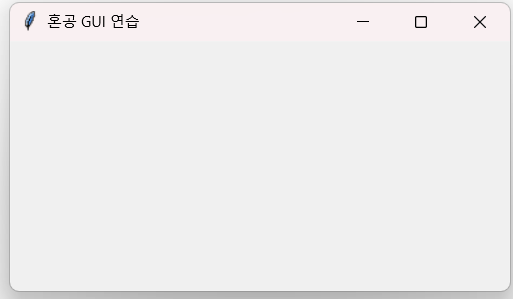
- **from tkinter import ** 문을 처음에 입력하면, 윈도 및 관련 내용을 사용할 수 있다. 
+) GUI란?
- Graphical User Interface의 약자로, 사용자가 편리하게 사용할 수 있도록 텍스트가 아닌 그래픽 환경을 제공
- 윈도 화면이 나오는 환경이라고 봐도 됨

#### 라벨
- 라벨(label)은 문자를 표현할 수 있는 위젯으로, **label(부모윈도, 옵션 ...)** 형식을 사용
- **위젯** 은 윈도에 나오는 버튼, 텍스트, 라디오 버튼, 이미지 등을 통합해서 지칭하는 용어
- 모든 위젯들은 **pack() 함수** 를 사용해야 화면에 나온다. 
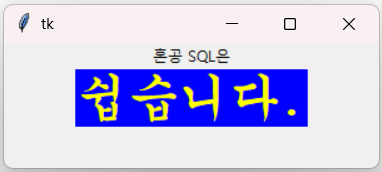

#### 버튼
- 버튼(button)은 마우스로 클릭하면 지정한 작업이 실행되도록 사용되는 위젯으로 **Button(부모윈도, 옵션 ...)** 형식을 사용하고, GUI에서 상당히 많이 사용되는 위젯이다.
- 라벨과는 달리 **command 옵션** 으로 사용자가 버튼을 눌렀을 때 지정한 작업을 처리해야 한다는 것이다. 
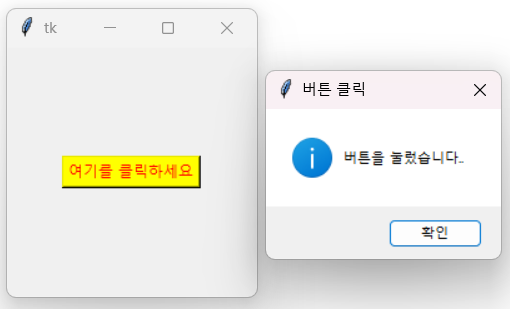

#### 위젯의 정렬
- pack() 함수의 옵션 중에서 가로로 정렬하는 방법으로 side=LEFT 또는 RIGHT 방식이 있다. 
- side=LEFT 옵션은 왼쪽부터 채워가라는 의미이고, side=RIGHT 옵션은 오른쪽부터 채워가라는 의미이다. 
- side=TOP 또는 BOTTOM 방식을 사용하면 수직으로 정렬할 수 있다.

#### 위젯 사이에 여백 추가
- pack() 함수의 옵션 중 padx=픽셀값 또는 pady=픽셀값 방식을 사용한다. 

#### 프레임, 엔트리, 리스트 박스
- **프레임(frame)** 은 화면을 여러 구역으로 나눌 떄 사용
- **엔트리(Entry)** 는 입력 상자를 표현
- **리스트박스(listbox)** 는 목록을 표현

### 확인문제
Q1. 다음은 파이썬에서 기본 윈도를 생성하기 위한 설명이다. 가장 거리가 먼 것을 하나 고르세요.
정답 : ③
-> tilte() 함수는 윈도의 크기가 아니라 제목을 설정하는 함수이다. 윈도의 크기는 geometry() 함수로 조절한다.
**보기별 해설**
① tkinter는 파이썬에서 GUI(그래픽 사용자 인터페이스)를 만들기 위한 표준 라이브러리로, 사용하려면 먼저 임포트해야 한다. 
② Tk() 함수는 프로그램의 기본 윈도의 루트 윈도(Root Window)를 생성할 때 사용한다.
④ mainloop() 함수는 윈도를 계속 실행 상태로 유지하면서 마우스 클릭이나 키보등 ㅣㅂ력 등 사용자의 이벤트를 처리한다. 

Q2. 다음은 라벨과 관련된 내용이다. 가장 거리가 먼 것을 하나 고르세요.
정답 : ④
-> bg 옵션은 라벨의 배경색을 지정한다. 글자의 색상은 fg 옵션으로 지정한다. 
** 보기별 해설**
① Label() 함수는 윈도에 텍스트나 이미지를 표시하는 라벨 위젯을 생서한다.
② text 옵션은 라벨에 표시할 글자 내용을 지정한다.
③ font 옵션은 글꼴의 종류, 크기, 스타일 등을 지정한다.

Q3. 다음은 버튼과 관련된 내용이다. 가장 거리가 먼 것을 하나 고르세요.
정답 : ③
-> function은 버튼 클릭 시 실행할 함수를 지정하는 올바른 옵션이 아니다. command 옵션을 사용해야 한다. 
**보기별 해설**
① Button() 함수는 윈도에 버튼 위젯을 생성한다.
② text 옵션은 버튼에 표시할 글자 내용을 지정한다.
④ fg 옵션은 버튼에 표시되는 글자의 색상을 지정한다. 

Q4. 다음은 위젯을 정렬하는 side 옵션의 값이다. 관련이 없는 것을 고르세요.
정답 : ③
-> UP : side 옵션에서 지원하지 않는 값이다. 위쪽에 배치하려면 TOP를 사용해야 한다. 
**보기별 해설**
① LEFT : 위젯을 왼쪽에 배치한다.
② RIGHT : 위젯을 오른쪽에 배치한다.
④ BOTTOM : 위젯을 아래쪽에 배치한다. 

---

이번 주는 마지막 주로 별도의 실습 과제는 진행하지 않습니다.

한 학기 동안 다소 부족한 커리큘럼이었음에도 불구하고 성실하게, 그리고 열심히 과제를 수행해주셔서 진심으로 감사드립니다.

이번 과정을 통해 배운 내용이 앞으로 여러분이 SQL을 다루는 데에 조금이나마 도움이 되기를 바랍니다.

여러분의 앞날을 진심으로 응원합니다. 😊


### 🎉 수고하셨습니다.


